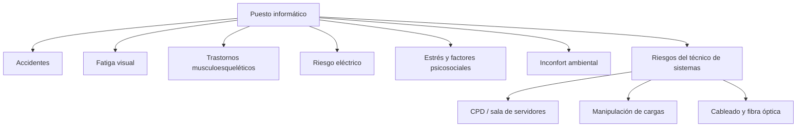
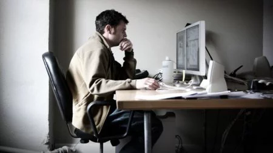
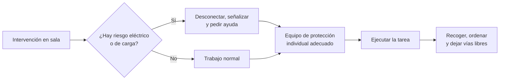
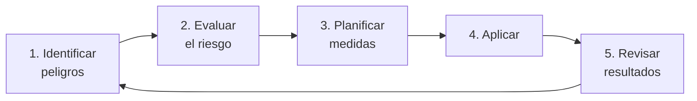

[README (1).md](https://github.com/user-attachments/files/35276624/README.1.md)

# 🛡️ Seguridad en el trabajo con equipos informáticos


> **Proyecto colaborativo:** `seguridad-trabajo-informática`
> Riesgos laborales y prevención de riesgos desde un punto de vista informático: del puesto de oficina a la sala de servidores.


<sub>*Figura 1. Puesto de trabajo informático ergonómico. Fuente: elaboración propia / indicar origen.*</sub>

---

## 📑 Índice

1. [Introducción](#1-introducción)
2. [Riesgos generales en el puesto informático](#2-riesgos-generales-en-el-puesto-informático)
3. [Riesgos ergonómicos](#3-riesgos-ergonómicos)
4. [Riesgos eléctricos](#4-riesgos-eléctricos)
5. [Riesgos específicos del técnico de sistemas](#5-riesgos-específicos-del-técnico-de-sistemas)
6. [Riesgos psicosociales y teletrabajo](#6-riesgos-psicosociales-y-teletrabajo)
7. [Pausas y ejercicios](#7-pausas-y-ejercicios)
8. [Normativa aplicable](#8-normativa-aplicable)
9. [Caso práctico: evaluación de un puesto](#9-caso-práctico-evaluación-de-un-puesto)
10. [Lista de comprobación del puesto](#10-lista-de-comprobación-del-puesto)
11. [Autoevaluación](#11-autoevaluación)
12. [Conclusiones](#12-conclusiones)
13. [Glosario](#13-glosario)
14. [Uso de herramientas de IA](#14-uso-de-herramientas-de-ia)
15. [Referencias](#15-referencias)
16. [Autores](#16-autores)

---

## 📁 Estructura del repositorio

```text
seguridad-trabajo-informatica/
├── README.md          ← este documento
└── imagenes/
    ├── 01-puesto-ergonomico.jpg
    ├── 02-medidas-ergonomicas.jpg
    ├── 03-riesgo-electrico.jpg
    ├── 04-ejercicios.jpg
    ├── 05-cpd-riesgos.jpg
    └── 06-caso-practico.jpg
```

---

## 1. Introducción

Hoy casi cualquier trabajo gira en torno a un ordenador. Pasar muchas horas delante de una **pantalla de visualización de datos (PVD)**, sentados y repitiendo los mismos movimientos con el teclado y el ratón, tiene consecuencias reales para la salud si el puesto no está bien diseñado.

En el caso de un técnico de sistemas o de redes, además, el trabajo no se limita a la mesa de oficina: se mueven equipos pesados, se trabaja con instalaciones eléctricas, en salas técnicas y con guardias fuera de horario.

Este trabajo resume los riesgos más habituales de un puesto informático y cómo prevenirlos. Se basa en el *Manual de buenas prácticas en oficinas y despachos* de la Junta de Andalucía[^1], reorganizado y ampliado por el grupo con riesgos propios del perfil de **Administración de Sistemas Informáticos en Red (ASIR)**.

Los riesgos principales se agrupan así:



---

## 2. Riesgos generales en el puesto informático

Son accidentes pequeños, pero muy frecuentes y casi siempre evitables:

| Situación de riesgo | Medida preventiva |
|---|---|
| Cajones y puertas abiertos | Mantenerlos cerrados para evitar golpes y caídas |
| Objetos cortantes (cúter, tijeras, chinchetas) | Guardarlos después de usarlos |
| Escaleras | Usar siempre el pasamanos |
| Vías de evacuación y extintores | No taparlos ni bloquearlos; saber dónde están |
| Fumar | Prohibido en el puesto de trabajo; hacerlo al aire libre |

> [!NOTE]
> Conviene fijarse de vez en cuando en dónde están los extintores y las salidas de emergencia. Ese hábito puede ser decisivo en una emergencia.

---

## 3. Riesgos ergonómicos

La **ergonomía** busca adaptar el puesto a las características físicas y mentales de la persona, y no al revés.


<sub>*Figura 2. Medidas ergonómicas básicas. Fuente: elaboración propia / indicar origen.*</sub>

### 3.1 Pantalla

- **Altura:** el borde superior de la pantalla debe quedar a la altura de los ojos.
- **Distancia:** entre 40 y 60 cm (las pantallas planas permiten distancias menores).
- **Posición:** justo enfrente, para no girar el cuello. Nunca delante ni detrás de una ventana, para evitar reflejos y deslumbramientos.
- **Parpadeo:** la frecuencia de refresco debe ser de al menos 70 Hz en pantallas CRT y 60 Hz en las planas (FPD/TFT).
- **Brillo y contraste:** ajustados para que no cansen la vista.
- **Varias pantallas:** si se usan dos monitores, el principal va delante y el secundario a un lado, para no girar el cuello de forma constante.
- **Tecnología:** las pantallas planas ocupan menos, emiten menos calor y menos radiación y consumen menos energía que las CRT.

<details>
<summary>🖱️ ¿Cómo comprobar la frecuencia de refresco? (Windows)</summary>

1. Clic derecho en el escritorio → *Configuración de pantalla*.
2. *Pantalla avanzada* → *Frecuencia de actualización*.
3. En versiones antiguas: *Propiedades* → *Configuración* → *Opciones avanzadas* → pestaña *Monitor*.

</details>

### 3.2 Teclado y ratón

- La fila de teclas ASD no debe estar elevada más de **3 cm**, para no forzar la muñeca.
- El ratón debe ajustarse al tamaño de la mano.
- Los codos deben estar **cerca del cuerpo**.
- Los reposamuñecas de gel evitan puntos de presión.
- Son preferibles los teclados y ratones **inalámbricos**, por su flexibilidad.
- Se recomienda colocar teclado y ratón a unos 10-15 cm del borde de la mesa, dejando unos **10 cm** libres delante del teclado para apoyar las manos.

### 3.3 Portátiles, tablets y accesorios

- El portátil tiene pantalla pequeña y teclado integrado, lo que carga el cuello y los brazos.
- **Solución:** soporte para el portátil más teclado y ratón externos.
- Un **atril** para documentos reduce los giros de cuello y el esfuerzo visual.
- Un **auricular inalámbrico** evita la postura de sujetar el teléfono con el hombro.
- El uso excesivo de PDA o móviles exige posturas estáticas del cuello y mucha atención visual.

### 3.4 Silla y mesa

- Silla con **ruedas y cinco apoyos** (estable) y regulable en altura.
- Brazo y antebrazo a **90º**, y muslo y pierna a **90º**, con los pies apoyados en el suelo. Si no se llega, usar un reposapiés antideslizante.
- Zona lumbar bien apoyada en el respaldo y mecanismo de basculación ajustado al peso de la persona.
- Mesa con acabado **mate** y colores suaves (menos reflejos), bordes redondeados y espacio libre para las piernas.
- Tablero de unos 80-100 cm de profundidad y 150 cm de longitud.

### 3.5 Condiciones ambientales

| Factor | Recomendación |
|---|---|
| 🌡️ Temperatura invierno | 20-24 ºC |
| 🌡️ Temperatura verano | 23-26 ºC |
| 💧 Humedad relativa | 45-65 % |
| 💡 Iluminación | Preferible luz natural; artificial uniforme y sin deslumbramientos; persianas o cortinas para controlar el sol |
| 🔊 Ruido | Atenuar o eliminar fuentes (impresoras, ventiladores...); respetar a los compañeros |
| 📐 Espacio | 2 m² libres por persona y pasillos de al menos 80 cm |

> [!NOTE]
> Las cifras de temperatura y humedad son valores de confort recomendados. El Real Decreto 486/1997 fija los límites legales (17-27 ºC en trabajos sedentarios y humedad entre el 30 y el 70 %).

> [!WARNING]
> El **Síndrome del Edificio Enfermo** (náuseas, dolor de cabeza, irritación de ojos, nariz y garganta) se relaciona con una mala ventilación. Es importante mantener bien los sistemas de ventilación y limpiar el puesto.

---

## 4. Riesgos eléctricos

Los equipos informáticos están conectados a la red eléctrica, así que el riesgo eléctrico es propio de nuestro entorno de trabajo.


<sub>*Figura 3. Enchufe sobrecargado frente a conexión correcta. Fuente: elaboración propia / indicar origen.*</sub>

**Buenas prácticas:**

- ❌ No sobrecargar los enchufes ni encadenar regletas.
- ❌ No tirar de los cables para desenchufar: se sujeta la clavija.
- ✅ Apagar ordenadores, impresoras y fotocopiadoras al terminar la jornada.
- ✅ Desenchufar lo que no se use y mantener los equipos con toma de tierra.
- ✅ Alejarse de cargadores y transformadores cuando sea posible: reduce la exposición a **campos electromagnéticos**.

### 4.1 Comportamiento eléctrico del cuerpo humano

El cuerpo humano conduce la electricidad, y el daño que causa una descarga depende de varios factores:

| Factor | Qué influye |
|---|---|
| **Intensidad** (mA) | Es el factor decisivo: a mayor intensidad que atraviesa el cuerpo, mayor gravedad (desde un cosquilleo hasta paro cardíaco). |
| **Resistencia** (Ω) | La piel seca ofrece mucha resistencia; la piel húmeda o mojada, mucha menos. Por eso nunca se tocan equipos con las manos mojadas. |
| **Tiempo de contacto** | Cuanto más dura el paso de corriente, más graves son las lesiones. |
| **Recorrido** | Es especialmente peligroso que la corriente atraviese el corazón (por ejemplo, de mano a mano o de mano a pie). |
| **Tipo de corriente** | La corriente alterna de la red doméstica es muy peligrosa a la frecuencia habitual (50 Hz). |

Relación entre ellos (ley de Ohm): **I = V / R**.

**Aplicado a un puesto informático:**

- Un cable pelado o una clavija rota puede provocar un contacto directo: se avisa y no se manipula.
- Los equipos con toma de tierra y los **interruptores diferenciales** de la instalación reducen el riesgo de que una derivación llegue a la persona.
- No se abren las fuentes de alimentación ni los equipos conectados a la red.
- Ante una persona electrizada, **no se la toca** hasta cortar la corriente; se llama al **112**.

> [!NOTE]
> Este apartado resume conceptos generales. Debe contrastarse y completarse con el contenido del vídeo *Comportamiento eléctrico* del curso.

---

## 5. Riesgos específicos del técnico de sistemas

Un administrador de sistemas no solo trabaja sentado. Estos son los riesgos que más se repiten en el perfil ASIR y que un manual de oficina no recoge.


<sub>*Figura 5. Riesgos habituales en un CPD. Fuente: elaboración propia / indicar origen.*</sub>

| Riesgo | Dónde aparece | Medidas preventivas |
|---|---|---|
| **Ruido** | CPD y salas de servidores (ventiladores y climatización) | Limitar el tiempo de permanencia, trabajar desde la consola remota y usar protección auditiva si se supera el nivel de acción (80 dB(A), RD 286/2006) |
| **Temperatura y aire** | Pasillos fríos/calientes del CPD | Ropa adecuada, pausas fuera de la sala y evitar permanecer en el pasillo caliente |
| **Manipulación de cargas** | Servidores, SAI, baterías y cajas de material | Usar carros o elevadores, pedir ayuda si la carga es voluminosa y levantar con la espalda recta; el RD 487/1997 considera 25 kg el máximo recomendado en condiciones ideales |
| **Caídas y golpes** | Cableado por el suelo, suelo técnico levantado, escaleras de mano | Canalizar y etiquetar cables, señalizar baldosas abiertas y usar escaleras homologadas (RD 2177/2004) |
| **Cortes y atrapamientos** | Rieles de rack, chapas, tapas de servidores | Guantes, manejo con cuidado y no meter las manos en guías con equipos en movimiento |
| **Riesgo eléctrico** | Cuadros, SAI, PDU y fuentes de alimentación | Solo personal autorizado (RD 614/2001), desconectar y señalizar antes de intervenir y no puentear protecciones |
| **Baterías de SAI** | Sala de baterías | Ventilación, no cortocircuitar bornes y guantes y gafas con baterías de plomo (ácido e hidrógeno) o litio (riesgo de incendio) |
| **Incendio y extinción por gas** | CPD con sistemas de extinción automática | Conocer las alarmas y las vías de salida, no bloquear puertas y abandonar la sala ante la alarma previa a la descarga |
| **Fibra óptica y láser** | Instalación y pruebas de enlaces | **Nunca mirar** directamente a un conector o a una fibra activa; recoger los restos de fibra, que son fragmentos de vidrio |
| **Trabajo en solitario y guardias** | Intervenciones nocturnas o en fin de semana | Avisar a un compañero, tener protocolo de comunicación y respetar los descansos |

> [!IMPORTANT]
> En un CPD, **la seguridad de las personas va antes que la disponibilidad del servicio**. Ningún servidor justifica saltarse un procedimiento de seguridad.



---

## 6. Riesgos psicosociales y teletrabajo

El estrés, la desmotivación o el absentismo suelen verse como problemas individuales, pero muchas veces nacen de una mala organización del trabajo. Medidas para reducirlos:

- **Variedad de tareas:** alternar teléfono, fotocopias y ordenador. Además favorece los cambios de postura.
- **Planificación realista del tiempo:** plazos imposibles generan estrés.
- **Atención al público:** alternar a las personas que atienden y formarlas para ello.
- **Intercambio de conocimiento:** la experiencia con la tecnología no siempre depende de la edad.
- **Conciliación y flexibilidad horaria**, además de comunicación abierta en el equipo.

### 6.1 Riesgos propios de los entornos TIC

- **Tecnoestrés:** malestar causado por el uso intensivo de las tecnologías, con sobrecarga de información, interrupciones constantes y la sensación de tener que estar siempre conectado.
- **Disponibilidad permanente:** las guardias y las incidencias urgentes en producción generan presión y alteran el sueño.
- **Desconexión digital:** es el derecho a no atender correos ni mensajes fuera de la jornada (art. 88 de la Ley Orgánica 3/2018 y art. 18 de la Ley 10/2021).

### 6.2 Teletrabajo

Cuando se trabaja desde casa, la empresa sigue siendo responsable de la prevención, pero la persona debe cuidar su espacio:

- Reservar una **zona de trabajo fija**, con silla regulable, pantalla a la altura de los ojos y teclado externo.
- **No trabajar con el portátil sobre el sofá o la cama.**
- Planificar los **horarios y las pausas**, y desconectar al terminar la jornada.
- Cuidar la **instalación eléctrica doméstica**: sin regletas encadenadas ni cables por el suelo.
- Mantener el contacto con el equipo para evitar el aislamiento.

---

## 7. Pausas y ejercicios

> [!TIP]
> Lo ideal es **alternar sentado y de pie**: unos 5-10 minutos de pie cada hora (ir a la impresora, subir por las escaleras, cambiar de tarea...).

Para la vista, una pauta muy conocida es la regla **20-20-20**: cada 20 minutos, mirar durante 20 segundos algo situado a unos 6 metros.

Ejercicios para repetir unas 15 veces, siempre **suaves y sin forzar**:

| Zona | Ejercicio |
|---|---|
| Espalda | Manos tras la cabeza, codos atrás y omoplatos juntos; abdominales contraídos con la zona lumbar contra el respaldo |
| Ojos | Cerrarlos un rato o mirar a lo lejos; moverlos en todas las direcciones |
| Cuello | Inclinar la cabeza adelante/atrás y a los lados; girarla lentamente |
| Hombros y brazos | Subir los hombros hacia las orejas y soltarlos; brazos en cruz y juntar los codos |
| Muñecas y manos | Abrir y cerrar las manos, girar las muñecas y estirar los dedos |


<sub>*Figura 4. Ejercicios de estiramiento en el puesto de trabajo. Fuente: elaboración propia / indicar origen.*</sub>

---

## 8. Normativa aplicable

| Norma | Contenido |
|---|---|
| [Ley 31/1995](https://www.boe.es/buscar/act.php?id=BOE-A-1995-24292) | Prevención de Riesgos Laborales |
| [Real Decreto 486/1997](https://www.boe.es/buscar/act.php?id=BOE-A-1997-8669) | Disposiciones mínimas de seguridad y salud en los lugares de trabajo |
| [Real Decreto 487/1997](https://www.boe.es/buscar/act.php?id=BOE-A-1997-8670) | Manipulación manual de cargas |
| [Real Decreto 488/1997](https://www.boe.es/buscar/act.php?id=BOE-A-1997-8671) | Trabajo con equipos que incluyen pantallas de visualización |
| [Real Decreto 614/2001](https://www.boe.es/buscar/act.php?id=BOE-A-2001-11881) | Protección frente al riesgo eléctrico |
| [Real Decreto 286/2006](https://www.boe.es/buscar/act.php?id=BOE-A-2006-3790) | Protección frente al ruido |
| Real Decreto 2177/2004 | Trabajos temporales en altura (escaleras de mano) |
| [Ley 10/2021](https://www.boe.es/buscar/act.php?id=BOE-A-2021-11472) | Trabajo a distancia y desconexión digital |
| [Ley 28/2005](https://www.boe.es/buscar/act.php?id=BOE-A-2005-21261) | Medidas sanitarias frente al tabaquismo |

---

## 9. Caso práctico: evaluación de un puesto

Para evaluar un riesgo se combinan dos variables: la **probabilidad** de que ocurra y la **severidad** de sus consecuencias (método simplificado del INSST).

| Probabilidad \ Consecuencias | Ligeramente dañino | Dañino | Extremadamente dañino |
|---|---|---|---|
| **Baja** | Trivial | Tolerable | Moderado |
| **Media** | Tolerable | Moderado | Importante |
| **Alta** | Moderado | Importante | Intolerable |



**Ejemplo:** puesto de un técnico de soporte en una oficina (caso ilustrativo elaborado por el grupo).


<sub>*Figura 6. Puesto del caso práctico, antes y después. Fuente: elaboración propia.*</sub>

| Peligro detectado | Riesgo inicial | Medida aplicada | Riesgo final |
|---|---|---|---|
| Portátil sobre la mesa, sin teclado externo | Importante | Soporte, teclado y ratón externos | Tolerable |
| Monitor frente a una ventana, con reflejos | Moderado | Reubicar el puesto y colocar persiana | Trivial |
| Regletas encadenadas bajo la mesa | Importante | Regleta única con protección y cables recogidos | Trivial |
| Pies sin apoyar en el suelo | Moderado | Reposapiés regulable | Trivial |
| Sin pausas en jornadas largas | Moderado | Recordatorio cada hora para levantarse | Tolerable |

**Conclusión del caso:** con medidas de bajo coste, los riesgos pasan de *importante* a *tolerable* o *trivial*.

---

## 10. Lista de comprobación del puesto

Comprueba tu propio puesto:

- [ ] La pantalla está frente a mí, a 40-60 cm, con el borde superior a la altura de los ojos
- [ ] No tengo ventanas delante ni detrás de la pantalla
- [ ] Codos pegados al cuerpo y ángulos de 90º
- [ ] Pies apoyados en el suelo o en un reposapiés
- [ ] Zona lumbar apoyada en el respaldo
- [ ] Teclado y ratón a 10-15 cm del borde, con muñecas apoyadas
- [ ] Enchufes sin sobrecargar y cables ordenados
- [ ] Extintores y salidas despejados
- [ ] Me levanto unos minutos cada hora
- [ ] Si trabajo con equipos pesados, uso carro o pido ayuda
- [ ] Si accedo a la sala de servidores, conozco las alarmas y las salidas

---

## 11. Autoevaluación

<details>
<summary><b>1.</b> ¿A qué altura debe quedar el borde superior de la pantalla?</summary>

A la **altura de los ojos**, a una distancia de entre 40 y 60 cm.

</details>

<details>
<summary><b>2.</b> ¿Qué haces antes de intervenir en un equipo conectado a la red eléctrica?</summary>

**Desconectarlo, señalizarlo** y comprobar que no hay tensión. Solo lo hace personal autorizado.

</details>

<details>
<summary><b>3.</b> ¿Qué haces si una persona queda electrizada?</summary>

**No tocarla** hasta cortar la corriente y llamar al **112**.

</details>

<details>
<summary><b>4.</b> ¿Qué riesgo especial tiene la fibra óptica?</summary>

Nunca se debe **mirar a un conector activo** (láser invisible), y los restos de fibra son fragmentos de vidrio.

</details>

<details>
<summary><b>5.</b> ¿Qué es la desconexión digital?</summary>

El derecho a **no atender comunicaciones de trabajo fuera de la jornada**.

</details>

---

## 12. Conclusiones

Un puesto informático seguro no depende de un único factor, sino de la suma de pequeños ajustes: postura, pantalla, iluminación, instalación eléctrica y organización del trabajo. En el perfil de administración de sistemas hay que sumar los riesgos de las salas técnicas, la manipulación de equipos y la disponibilidad permanente.

La prevención es responsabilidad de la empresa, pero también de cada persona trabajadora, que debe conocer las medidas y aplicarlas a diario. Como se ve en el caso práctico, la mayoría de las mejoras son sencillas y baratas.

---

## 13. Glosario

| Término | Significado |
|---|---|
| **PVD** | Pantalla de visualización de datos |
| **CPD** | Centro de procesamiento de datos (sala de servidores) |
| **SAI** | Sistema de alimentación ininterrumpida (alimenta los equipos si falla la red) |
| **PDU** | Unidad de distribución de energía de un rack |
| **EPI** | Equipo de protección individual |
| **Ergonomía** | Adaptación del puesto a la persona |
| **Tecnoestrés** | Estrés causado por el uso intensivo de las tecnologías |
| **Evaluación de riesgos** | Proceso para estimar la probabilidad y la gravedad de un daño |

---

## 14. Uso de herramientas de IA

Para elaborar este trabajo se ha utilizado ChatGPT como apoyo para estructurar y redactar contenidos. El grupo ha revisado y contrastado la información con las fuentes de la sección de referencias.

---

## 15. Referencias

- Junta de Andalucía, Consejería de Empleo. *Guía de prevención de riesgos laborales en oficinas y despachos. Manual de buenas prácticas.* Fundación Andaluza Fondo de Formación y Empleo.
- [Ley 31/1995 de Prevención de Riesgos Laborales (BOE)](https://www.boe.es/buscar/act.php?id=BOE-A-1995-24292)
- [Real Decreto 486/1997, lugares de trabajo (BOE)](https://www.boe.es/buscar/act.php?id=BOE-A-1997-8669)
- [Real Decreto 487/1997, manipulación manual de cargas (BOE)](https://www.boe.es/buscar/act.php?id=BOE-A-1997-8670)
- [Real Decreto 488/1997, pantallas de visualización (BOE)](https://www.boe.es/buscar/act.php?id=BOE-A-1997-8671)
- [Real Decreto 614/2001, riesgo eléctrico (BOE)](https://www.boe.es/buscar/act.php?id=BOE-A-2001-11881)
- [Real Decreto 286/2006, ruido (BOE)](https://www.boe.es/buscar/act.php?id=BOE-A-2006-3790)
- [Ley 10/2021, trabajo a distancia (BOE)](https://www.boe.es/buscar/act.php?id=BOE-A-2021-11472)
- [INSST – Instituto Nacional de Seguridad y Salud en el Trabajo](https://www.insst.es): guías técnicas y Notas Técnicas de Prevención (por ejemplo, la NTP 730 sobre tecnoestrés).
- Vídeo: *Comportamiento eléctrico* (material del curso).

[^1]: Contenido reelaborado por el grupo a partir del manual de la Junta de Andalucía; no se reproduce de forma literal.

---

## 16. Autores

| Nombre | GitHub | Apartados |
|---|---|---|
| Nombre Apellido 1 | [@usuario1](https://github.com/usuario1) | Introducción, riesgos generales, glosario |
| Nombre Apellido 2 | [@usuario2](https://github.com/usuario2) | Ergonomía, caso práctico |
| Nombre Apellido 3 | [@usuario3](https://github.com/usuario3) | Riesgos eléctricos, riesgos del técnico de sistemas |
| Nombre Apellido 4 | [@usuario4](https://github.com/usuario4) | Psicosociales y teletrabajo, ejercicios, normativa, conclusiones |

*Proyecto realizado con fines educativos.*
