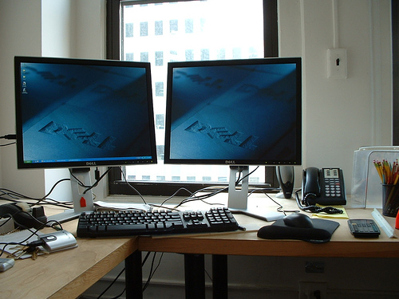
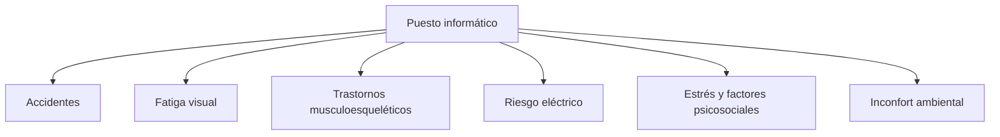

# seguridad-trabajo-informa[README.md](https://github.com/user-attachments/files/35276131/README.md)
# 🛡️ Seguridad en el trabajo con equipos informáticos

> **Proyecto colaborativo:** `seguridad-trabajo-informática`
> Riesgos laborales y prevención de riesgos desde un punto de vista informático.

---

## 📑 Índice

1. [Introducción](#1-introducción)
2. [Riesgos generales en el puesto informático](#2-riesgos-generales-en-el-puesto-informático)
3. [Riesgos ergonómicos](#3-riesgos-ergonómicos)
4. [Riesgos eléctricos](#4-riesgos-eléctricos)
5. [Riesgos psicosociales](#5-riesgos-psicosociales)
6. [Pausas y ejercicios](#6-pausas-y-ejercicios)
7. [Normativa aplicable](#7-normativa-aplicable)
8. [Lista de comprobación del puesto](#8-lista-de-comprobación-del-puesto)
9. [Conclusiones](#9-conclusiones)
10. [Referencias](#10-referencias)
11. [Autores](#11-autores)

---

## 1. Introducción

Hoy casi cualquier trabajo gira en torno a un ordenador. Pasar muchas horas delante de una **pantalla de visualización de datos (PVD)**, sentados y repitiendo los mismos movimientos con el teclado y el ratón, tiene consecuencias reales para la salud si el puesto no está bien diseñado.

Este trabajo resume los riesgos más habituales de un puesto informático y cómo prevenirlos. Se basa en el *Manual de buenas prácticas en oficinas y despachos* de la Junta de Andalucía[^1], reorganizado y ampliado por el grupo.

Los riesgos principales se pueden agrupar así:

---

## 2. Riesgos generales en el puesto informático

Son accidentes pequeños, pero muy frecuentes y casi siempre evitables:

| Situación de riesgo | Medida preventiva |
|---|---|
| Cajones y puertas abiertos | Mantenerlos cerrados para evitar golpes y caídas |
| Objetos cortantes (cúter, tijeras, chinchetas) | Guardarlos después de usarlos |
| Escaleras | Usar siempre el pasamanos |
| Vías de evacuación y extintores | No taparlos ni bloquearlos; saber dónde están |
| Fumar | Prohibido en el puesto de trabajo; hacerlo al aire libre |

> [!NOTE]
> Conviene fijarse de vez en cuando en dónde están los extintores y las salidas de emergencia. Ese hábito puede ser decisivo en una emergencia.

---

## 3. Riesgos ergonómicos

La **ergonomía** busca adaptar el puesto a las características físicas y mentales de la persona, y no al revés.

### 3.1 Pantalla

- **Altura:** el borde superior de la pantalla debe quedar a la altura de los ojos.
- **Distancia:** entre 40 y 60 cm (las pantallas planas permiten distancias menores).
- **Posición:** justo enfrente, para no girar el cuello. Nunca delante ni detrás de una ventana, para evitar reflejos y deslumbramientos.
- **Parpadeo:** la frecuencia de refresco debe ser de al menos 70 Hz en pantallas CRT y 60 Hz en las planas (FPD/TFT).
- **Brillo y contraste:** ajustados para que no cansen la vista.
- **Tecnología:** las pantallas planas ocupan menos, emiten menos calor y menos radiación y consumen menos energía que las CRT.

🖱️ ¿Cómo comprobar la frecuencia de refresco? (Windows clásico)

1. Clic derecho en el escritorio → *Propiedades*.
2. Pestaña *Configuración* → *Opciones avanzadas*.
3. Pestaña *Monitor* → ahí se elige la frecuencia de actualización.

### 3.2 Teclado y ratón

- La fila de teclas ASD no debe estar elevada más de **3 cm**, para no forzar la muñeca.
- El ratón debe ajustarse al tamaño de la mano.
- Los codos deben estar **cerca del cuerpo**.
- Los reposamuñecas de gel evitan puntos de presión.
- Son preferibles los teclados y ratones **inalámbricos**, por su flexibilidad.
- Colocad teclado y ratón a unos 10-15 cm del borde de la mesa y dejad unos **10 cm** libres delante del teclado para apoyar las manos.

### 3.3 Portátiles, tablets y accesorios

- El portátil tiene pantalla pequeña y teclado integrado, lo que carga el cuello y los brazos.
- **Solución:** soporte para el portátil más teclado y ratón externos.
- Un **atril** para documentos reduce los giros de cuello y el esfuerzo visual.
- Un **auricular inalámbrico** evita la postura de sujetar el teléfono con el hombro.
- El uso excesivo de PDA o móviles exige posturas estáticas del cuello y mucha atención visual.

### 3.4 Silla y mesa

- Silla con **ruedas y cinco apoyos** (estable) y regulable en altura.
- Brazo y antebrazo a **90º**, y muslo y pierna a **90º**, con los pies apoyados en el suelo. Si no llegáis, usad un reposapiés antideslizante.
- Zona lumbar bien apoyada en el respaldo, y mecanismo de basculación ajustado a vuestro peso.
- Mesa con acabado **mate** y colores suaves (menos reflejos), bordes redondeados y espacio libre para las piernas.
- Tablero de unos 80-100 cm de profundidad y 150 cm de longitud.

### 3.5 Condiciones ambientales

| Factor | Recomendación |
|---|---|
| 🌡️ Temperatura invierno | 20-24 ºC |
| 🌡️ Temperatura verano | 23-26 ºC |
| 💧 Humedad relativa | 45-65 % |
| 💡 Iluminación | Preferible luz natural; artificial uniforme y sin deslumbramientos; persianas o cortinas para controlar el sol |
| 🔊 Ruido | Atenuar o eliminar fuentes (impresoras, ventiladores...); respetar a los compañeros |
| 📐 Espacio | 2 m² libres por persona y pasillos de al menos 80 cm |

> [!WARNING]
> El **Síndrome del Edificio Enfermo** (náuseas, dolor de cabeza, irritación de ojos, nariz y garganta) se relaciona con una mala ventilación. Es importante mantener bien los sistemas de ventilación y limpiar el puesto.

---

## 4. Riesgos eléctricos

Los equipos informáticos están conectados a la red eléctrica, así que el riesgo eléctrico es propio de nuestro entorno de trabajo.

**Buenas prácticas:**

- ❌ No sobrecargar los enchufes ni encadenar regletas.
- ❌ No tirar de los cables para desenchufar: se sujeta la clavija.
- ✅ Apagar ordenadores, impresoras y fotocopiadoras al terminar la jornada.
- ✅ Desenchufar lo que no se use y mantener los equipos con toma de tierra.
- ✅ Alejarse de cargadores y transformadores cuando sea posible: reduce la exposición a **campos electromagnéticos**.

### Comportamiento eléctrico del cuerpo humano

> 🎬 *Apartado pendiente de completar con el contenido del vídeo "Comportamiento eléctrico" (conceptos sobre cómo reacciona el cuerpo a la corriente, intensidad, resistencia, etc.).*

- [ ] Resumir las ideas principales del vídeo
- [ ] Añadir un ejemplo aplicado a un puesto informático

---

## 5. Riesgos psicosociales

El estrés, la desmotivación o el absentismo suelen verse como problemas individuales, pero muchas veces nacen de una mala organización del trabajo. Medidas para reducirlos:

- **Variedad de tareas:** alternar teléfono, fotocopias y ordenador. Además favorece los cambios de postura.
- **Planificación realista del tiempo:** plazos imposibles generan estrés.
- **Atención al público:** alternar a las personas que atienden y formarlas para ello.
- **Intercambio de conocimiento:** la experiencia con la tecnología no siempre depende de la edad.
- **Conciliación y flexibilidad horaria**, además de comunicación abierta en el equipo.

---

## 6. Pausas y ejercicios

> [!TIP]
> Lo ideal es **alternar sentado y de pie**: unos 5-10 minutos de pie cada hora (ir a la impresora, subir por las escaleras, cambiar de tarea...).

Ejercicios para repetir unas 15 veces, siempre **suaves y sin forzar**:

| Zona | Ejercicio |
|---|---|
| Espalda | Manos tras la cabeza, codos atrás y omoplatos juntos; abdominales contraídos con la zona lumbar contra el respaldo |
| Ojos | Cerrarlos un rato o mirar a lo lejos; moverlos en todas las direcciones |
| Cuello | Inclinar la cabeza adelante/atrás y a los lados; girarla lentamente |
| Hombros y brazos | Subir los hombros hacia las orejas y soltarlos; brazos en cruz y juntar los codos |

---

## 7. Normativa aplicable

- **Ley 31/1995**, de Prevención de Riesgos Laborales.
- **Real Decreto 486/1997**: disposiciones mínimas de seguridad y salud en los lugares de trabajo.
- **Real Decreto 488/1997**: trabajo con equipos que incluyen pantallas de visualización.
- **Ley 28/2005**: medidas sanitarias frente al tabaquismo.

---

## 8. Lista de comprobación del puesto

Comprobad vuestro propio puesto:

- [ ] La pantalla está frente a mí, a 40-60 cm, con el borde superior a la altura de los ojos
- [ ] No tengo ventanas delante ni detrás de la pantalla
- [ ] Codos pegados al cuerpo y ángulos de 90º
- [ ] Pies apoyados en el suelo o en un reposapiés
- [ ] Zona lumbar apoyada en el respaldo
- [ ] Teclado y ratón a 10-15 cm del borde, con muñecas apoyadas
- [ ] Enchufes sin sobrecargar y cables ordenados
- [ ] Extintores y salidas despejados
- [ ] Me levanto unos minutos cada hora

---

## 9. Conclusiones

Un puesto informático seguro no depende de un único factor, sino de la suma de pequeños ajustes: postura, pantalla, iluminación, instalación eléctrica y organización del trabajo. La prevención es responsabilidad de la empresa, pero también de cada persona trabajadora, que debe conocer las medidas y aplicarlas a diario.

---

## 10. Referencias

- Junta de Andalucía, Consejería de Empleo. *Guía de prevención de riesgos laborales en oficinas y despachos. Manual de buenas prácticas.* Fundación Andaluza Fondo de Formación y Empleo.
- [Ley 31/1995 de Prevención de Riesgos Laborales (BOE)](https://www.boe.es/buscar/act.php?id=BOE-A-1995-24292)
- [Real Decreto 488/1997 sobre pantallas de visualización (BOE)](https://www.boe.es/buscar/act.php?id=BOE-A-1997-8671)
- [INSST – Instituto Nacional de Seguridad y Salud en el Trabajo](https://www.insst.es)
- Vídeo: *Comportamiento eléctrico* (material del curso).

[^1]: Contenido reelaborado por el grupo a partir del manual de la Junta de Andalucía; no se reproduce de forma literal.

---

## 11. Autores

| Nombre | GitHub | Apartados |
|---|---|---|
| Nombre Apellido 1 | [@usuario1](https://github.com/usuario1) | Introducción, riesgos generales |
| Nombre Apellido 2 | [@usuario2](https://github.com/usuario2) | Ergonomía |
| Nombre Apellido 3 | [@usuario3](https://github.com/usuario3) | Riesgos eléctricos, psicosociales |
| Nombre Apellido 4 | [@usuario4](https://github.com/usuario4) | Ejercicios, normativa, conclusiones |

*Proyecto realizado con fines educativos.*
